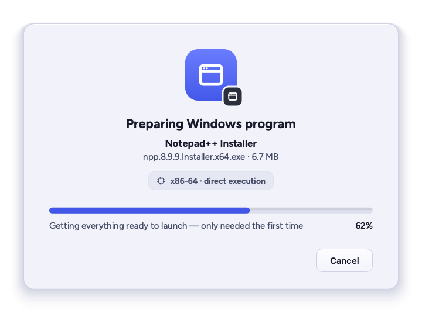
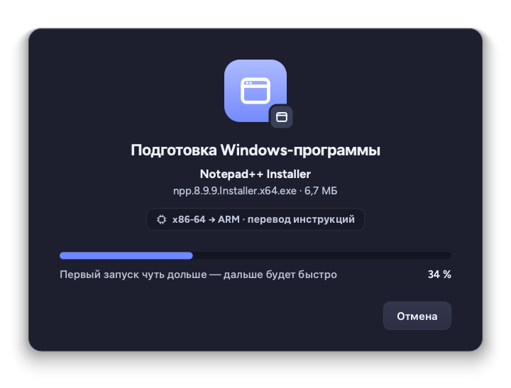

# Launch sheet for lucent-bridge

`lucent-bridge-sheet` is the calm "Preparing Windows program" window of
`docs/mockups/05-exe-launch.png` (x86-64) and `05b-exe-launch-arm.png` (ARM),
in Pebble Drift, light and dark, English and Russian.

[lucent-bridge](https://github.com/sidun-av/lucent-bridge) (0.2+) starts it
only when there is something to show — a first launch that prepares the
Windows environment, components being installed, or an explanation of what
can't work — and writes its progress to the sheet's stdin as JSON lines
(protocol 1, the same lines `lucent-bridge run --progress-fd N` writes; see
the bridge README, "Launch sheet and progress protocol"). The sheet answers
through its exit status: 0 done or closed, 2 Cancel, 3 "Run anyway".

- `lucent_bridge_sheet/model.py`: the state and every string, a pure function
  of the events (tests/test_model.py).
- `lucent_bridge_sheet/sheet.py`: the window, painted from the design tokens
  (`lucent_migrate.tokens`, a copy of pebble-drift.css part 1), Figtree from
  Lucent Settings, then Inter. Real `QPushButton`s for Tab/Enter/Esc.
- `lucent_bridge_sheet/app.py`: reads stdin, decides when the sheet goes
  away (at least 1.2 s on screen; 2.5 s after the program starts; an
  explanation stays until closed), `--preview NAME --out FILE.png` renders a
  sample.
- `po/ru.po`: Russian. Error texts come translated from lucent-bridge.

```sh
cd apps/lucent-bridge-sheet
QT_QPA_PLATFORM=offscreen pytest
QT_QPA_PLATFORM=offscreen PYTHONPATH=.:../../migration-wizard \
    python3 -m lucent_bridge_sheet --preview preparing --theme dark --out /tmp/sheet.png
```

Offscreen renders of the samples (`docs/`; Qt's offscreen platform, not a
Plasma session — the sheet in a real session is in
`docs/screenshots/real/x86-acceptance/03-launch-sheet.png`; the samples have
no program icon, so the Windows-program tile stands in):

| Preparing, x86-64, light | Preparing, ARM, dark, Russian |
| --- | --- |
|  |  |

| Hibernated Windows disk, light | Kernel anti-cheat, dark, Russian |
| --- | --- |
|  |  |
